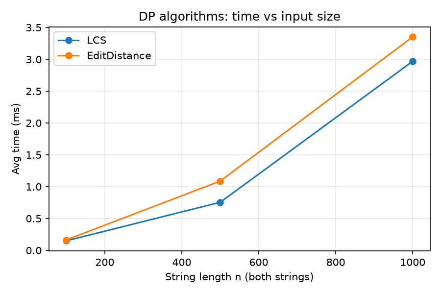
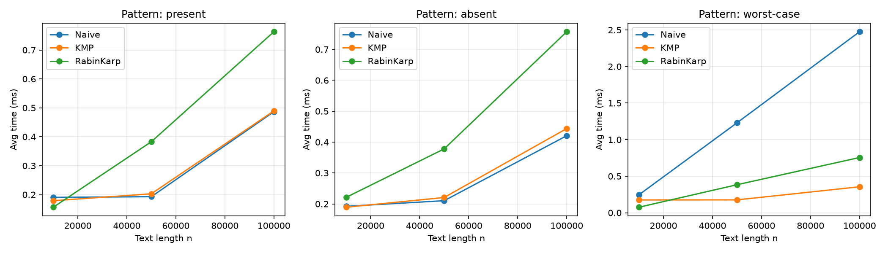
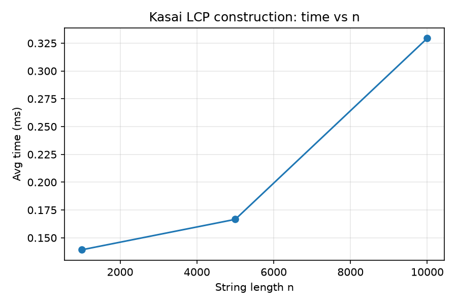

# Assignment 4 — Text Analysis: Dynamic Programming and String Algorithms
Daniyal Akylbek
SE - 2530

Java implementation and evaluation of LCS, Edit Distance, Naive / KMP / Rabin–Karp string matching and Kasai's LCP algorithm.
No library implementations of these algorithms are used (only `java.util` for lists, sorting and `Random`).

## 1. Problem description and algorithm overview

| Part | Algorithm | Problem solved |
|---|---|---|
| A | LCS | Length of the longest subsequence common to two strings |
| A | Edit Distance | Minimum number of insertions / deletions / substitutions turning `a` into `b` |
| B | Naive | All occurrences of a pattern by trying every alignment (baseline) |
| B | KMP | All occurrences using the LPS (failure) table; the text pointer never moves back |
| B | Rabin–Karp | All occurrences using a rolling hash, verifying every hash hit |
| C | Kasai | LCP array from a string and its suffix array in linear time |

### Why the recurrences are correct

**LCS.** Let `dp[i][j]` = LCS length of `a[0..i)` and `b[0..j)`. Base: `dp[0][j] = dp[i][0] = 0` (an empty string has no common subsequence).
If `a[i-1] == b[j-1]`, some optimal subsequence can use this matching pair (exchange argument), so `dp[i][j] = dp[i-1][j-1] + 1`.
Otherwise the two last characters cannot both be in the subsequence's end, so at least one is unused: `dp[i][j] = max(dp[i-1][j], dp[i][j-1])`.
Every subproblem depends only on smaller prefixes, so filling the table row by row is valid.

**Edit Distance.** `dp[i][j]` = min edits turning `a[0..i)` into `b[0..j)`. Base: `dp[i][0] = i` (delete all), `dp[0][j] = j` (insert all).
Consider the last operation in an optimal script: substitute / match the last characters (`dp[i-1][j-1] + cost`, cost 0 if equal else 1), delete `a[i-1]` (`dp[i-1][j] + 1`) or insert `b[j-1]` (`dp[i][j-1] + 1`). The minimum of the three covers all possibilities.

**KMP.** `lps[i]` is the length of the longest proper prefix of `p[0..i]` that is also a suffix of it. If `j` characters matched and the next one mismatches, the longest prefix of the pattern that can still be a suffix of the text read so far has length `lps[j-1]`, so we continue with `j = lps[j-1]` instead of re-reading text characters. The text index `i` only increases, and `j` can decrease at most as often as it has increased, giving O(n) amortized.

**Rabin–Karp.** The window hash is `H = Σ t[i+k]·B^(m-1-k) mod P` and is updated in O(1): `H' = ((H − t[i]·B^(m-1))·B + t[i+m]) mod P`. Equal strings always have equal hashes, but different strings can too (collision). Therefore **every hash match is verified character by character**; a failed verification is counted as a "spurious hit". Collisions only affect speed, never correctness. Parameters: `B = 256`, `P = 1_000_000_007`.

**Kasai.** `lcp[k]` = length of the longest common prefix of the suffixes `sa[k-1]` and `sa[k]` (`lcp[0] = 0`). Suffixes are processed in text order `i = 0..n-1`. If suffix `i` has LCP `h` with its predecessor in sorted order, then suffix `i+1` has LCP at least `h-1` with its predecessor, so `h` is decreased by 1 (not reset to 0) and then extended. `h` increases at most `2n` times in total → O(n).

## 2. Implementation decisions and assumptions

- **Empty pattern:** matches at every position `0..n` (n+1 indices); identical in Naive, KMP and Rabin–Karp.
- **Pattern longer than text:** empty result. Overlapping occurrences are all reported (`"aa"` in `"aaaaa"` → 0,1,2,3).
- **Operation counts:** *character comparisons*. KMP counts include building the LPS table; Rabin–Karp counts only comparisons made during verification (hash arithmetic is not counted). For LCS / Edit Distance the "operations" column is the number of DP cells `n·m`.
- **LCS / Edit Distance:** use the full `(n+1)×(m+1)` table (O(nm) space). Returning only the length / distance would allow O(min(n,m)) space with two rows, but the full table was kept for clarity (and so that a traceback could be added).
- **Suffix array:** for Kasai is built by simply sorting suffixes (`SuffixArrayUtil`). This is allowed by the assignment and is **not** timed.
- **Alphabet:** `ACGT` (size 4) for all random strings. **Seed:** `42 + size` (a fixed random seed per input size, so all algorithms receive identical inputs).
- **Patterns for matching:** length 20. *Present*: substring of the text starting at `n/2`. *Absent*: random length-20 string re-generated until the naive search finds no occurrence. *Worst-case* (extra scenario): text `A^n`, pattern `A^19 C`, which is the adversarial case for Naive.

## 3. Complexity analysis

n, m = lengths of the two strings (for matching: n = text length, m = pattern length); σ = alphabet size.

| Algorithm | Main operation / recurrence | Best case | Worst case | Aux. space | Justification |
|---|---|---|---|---|---|
| LCS | `dp[i][j] = dp[i-1][j-1]+1` or `max(dp[i-1][j], dp[i][j-1])` | Θ(nm) | Θ(nm) | O(nm) (O(min(n,m)) with 2 rows) | `(n+1)(m+1)` cells, O(1) work each, no early exit |
| Edit Distance | `dp[i][j] = min(dp[i-1][j-1]+c, dp[i-1][j]+1, dp[i][j-1]+1)` | Θ(nm) | Θ(nm) | O(nm) | same table structure |
| Naive | compare pattern at each shift | O(n) (mismatch on 1st char each shift) | O((n−m+1)·m) ≈ O(nm) | O(1) | worst case: `aaaa…` vs `aaa…b` |
| KMP | LPS table + amortized pointer moves | O(n+m) | O(n+m) | O(m) | preprocessing O(m); search ≤ 2n comparisons since `i` never decreases and `j` decreases ≤ number of increases |
| Rabin–Karp | rolling hash + verify on hash hit | O(n+m) | O(nm) | O(1) | expected O(n+m) with few collisions; worst case if many hash collisions or many true matches that need O(m) verification |
| Kasai | `h` is reused: `h ← h−1` after each step | O(n) | O(n) | O(n) (`rank` + `lcp` arrays) | `h` increases ≤ 2n times overall; the suffix array itself is input |

**Theory vs. measurement.** Big-O values describe how work *grows*, not wall-clock time. Measured times include JIT, memory, cache and GC effects and are noisy for sub-millisecond runs. Operation counts (comparisons, DP cells) are deterministic and are the more reliable evidence for the theory.
- **Expected vs. worst case:** Rabin–Karp is O(n+m) *in expectation* (hash collisions are rare for a good modulus) but O(nm) in the worst case. KMP and Kasai have the same bound in all cases. Naive is fast on random text with a mismatch on the first character, but quadratic-like on repetitive inputs.

## 4. Testing strategy and results

Tests are in `src/test/java/textanalysis/AllTests.java` (plain Java, no framework: run `java -cp out textanalysis.AllTests`). Current result: **51 passed, 0 failed.**

- **LCS:** identical strings, completely different strings, empty string, both empty, classic `AGGTAB / GXTXAYB = 4`.
- **Edit Distance:** identical, one empty (both directions), substitution, insertion, deletion, `kitten → sitting = 3`.
- **Matching:** (every case is run on Naive, KMP *and* Rabin–Karp and compared with the expected list, so all three must return the same indices): pattern at beginning / middle / end, multiple and overlapping occurrences, absent, longer than text, empty pattern, empty text, pattern equal to text. Additionally a randomized cross-check of 2000 random cases (alphabet `ACGT`) verifying `Naive == KMP == Rabin–Karp`. KMP LPS table check `"ababaca" → [0,0,1,2,3,0,1]`.
- **Kasai:** `"banana"` — suffixes in sorted order: `a(5), ana(3), anana(1), banana(0), na(4), nana(2)` → `SA = [5,3,1,0,4,2]`, `LCP = [0,1,3,0,0,2]` (checked by hand: lcp(a, ana)=1, lcp(ana, anana)=3, lcp(anana, banana)=0, lcp(banana, na)=0, lcp(na, nana)=2). Also `"abab"` (`SA=[2,0,3,1]`, `LCP=[0,2,0,1]`) and 300 random strings compared against brute-force LCP.

**LCP array meaning:** `lcp[k]` is the longest common prefix of two lexicographically adjacent suffixes. It is used e.g. to count distinct substrings (`n(n+1)/2 − Σ lcp`), find the longest repeated substring (`max lcp`) and speed up pattern search in a suffix array.

## 5. Experimental setup

- Inputs: LCS and Edit Distance n = 100, 500, 1000; matching text lengths 10,000, 50,000, 100,000 (patterns present / absent / worst-case); Kasai n = 1000, 5000, 10,000.
- Random strings over `ACGT`, seed `42 + size`. The same strings/patterns are used for all algorithms solving the same task.
- Timing: `System.nanoTime()` around the algorithm call only. 20 untimed warm-up runs (JIT), then **5 timed runs; the average is reported**. Input generation, suffix-array construction, printing and file output are outside the timed regions. Results are stored in `results/results.csv`.

## 6. Results

### DP algorithms

| n | LCS time (ms) | Edit Distance time (ms) | DP cells | LCS length | Edit distance |
|---|---|---|---|---|---|
| 100 | 0.149 | 0.164 | 10000 | 61 | 56 |
| 500 | 0.754 | 1.088 | 250000 | 320 | 262 |
| 1000 | 2.968 | 3.352 | 1000000 | 647 | 524 |

### String matching — pattern present

| Text length | Algorithm | Time (ms) | Char comparisons | Matches |
|---|---|---|---|---|
| 10000 | Naive | 0.1906 | 13416 | 1 |
| 10000 | KMP | 0.1790 | 12529 | 1 |
| 10000 | RabinKarp | 0.1565 | 20 | 1 |
| 50000 | Naive | 0.1929 | 66677 | 1 |
| 50000 | KMP | 0.2029 | 61831 | 1 |
| 50000 | RabinKarp | 0.3828 | 20 | 1 |
| 100000 | Naive | 0.4866 | 132915 | 1 |
| 100000 | KMP | 0.4893 | 124696 | 1 |
| 100000 | RabinKarp | 0.7630 | 20 | 1 |

### String matching — pattern absent

| Text length | Algorithm | Time (ms) | Char comparisons | Matches |
|---|---|---|---|---|
| 10000 | Naive | 0.1921 | 13308 | 0 |
| 10000 | KMP | 0.1892 | 12455 | 0 |
| 10000 | RabinKarp | 0.2211 | 0 | 0 |
| 50000 | Naive | 0.2103 | 66475 | 0 |
| 50000 | KMP | 0.2207 | 62436 | 0 |
| 50000 | RabinKarp | 0.3780 | 0 | 0 |
| 100000 | Naive | 0.4206 | 133283 | 0 |
| 100000 | KMP | 0.4438 | 125023 | 0 |
| 100000 | RabinKarp | 0.7572 | 0 | 0 |

### String matching — pattern worst-case

| Text length | Algorithm | Time (ms) | Char comparisons | Matches |
|---|---|---|---|---|
| 10000 | Naive | 0.2453 | 199620 | 0 |
| 10000 | KMP | 0.1751 | 20018 | 0 |
| 10000 | RabinKarp | 0.0755 | 0 | 0 |
| 50000 | Naive | 1.2296 | 999620 | 0 |
| 50000 | KMP | 0.1760 | 100018 | 0 |
| 50000 | RabinKarp | 0.3830 | 0 | 0 |
| 100000 | Naive | 2.4751 | 1999620 | 0 |
| 100000 | KMP | 0.3552 | 200018 | 0 |
| 100000 | RabinKarp | 0.7552 | 0 | 0 |

### Kasai's algorithm

| n | Time (ms) |
|---|---|
| 1000 | 0.1392 |
| 5000 | 0.1666 |
| 10000 | 0.3294 |

Plots (generated by `plot.py`):





## 7. Discussion: theory vs. experiments

The experimental results strongly align with the theoretical time complexities:

- **LCS and Edit Distance:** The execution time and the number of processed DP cells grow quadratically. When the input size increases by a factor of 10 (from 100 to 1000), the number of DP cells increases exactly by a factor of 100 (from 10,000 to 1,000,000). The execution time similarly scales from ~0.15 ms to ~2.97 ms, strictly confirming the $O(nm)$ complexity.
- **String Matching (Worst-case):** The difference between theoretical bounds is clearly visible in the worst-case scenario. For a text length of 100,000, the Naive algorithm performed nearly 2,000,000 character comparisons (taking 2.48 ms), demonstrating its $O(nm)$ worst-case behavior. In contrast, KMP performed only 200,018 comparisons (taking 0.36 ms), proving its strict $O(n+m)$ efficiency by avoiding redundant text pointer backtracking.
- **Rabin-Karp Overhead:** While Rabin-Karp made only 20 character comparisons in the successful search (exclusively for hash verification), its overall execution time (0.76 ms for text length 100,000) was higher than KMP (0.49 ms). This highlights the constant-factor overhead of modular arithmetic required at each window shift, making it slightly slower than KMP in wall-clock time for these specific inputs, despite having the same expected $O(n+m)$ complexity.
- **Kasai's Algorithm:** The performance demonstrates a roughly linear growth with respect to input size $n$. Measurements for small inputs like $n=1000$ (0.14 ms) versus $n=5000$ (0.17 ms) show some non-monotonic noise likely due to JVM warm-up or cache effects, but the jump to $n=10,000$ (0.33 ms) accurately reflects the expected $O(n)$ behavior.

## 8. Conclusion — main trade-offs

- **DP (LCS / Edit Distance):** exact, simple, but Θ(nm) time and space; the space can be reduced to two rows when only the value is needed.
- **Naive:** no preprocessing, O(1) space, very fast on "easy" random inputs, but O(nm) on repetitive ones.
- **KMP:** guaranteed O(n+m) in all cases, needs O(m) extra memory; best choice when worst-case guarantees matter.
- **Rabin–Karp:** simple, O(1) space, expected linear time, extends naturally to multi-pattern search; has a worst case of O(nm) and depends on the hash parameters.
- **Kasai:** linear-time LCP construction on top of a suffix array; the cost of building the suffix array itself is not included.

## How to build and run

Requirements: JDK 17+ (tested with 21), Python 3 + matplotlib (for plots only).

```bash
   javac -d out src/main/java/textanalysis/*.java src/test/java/textanalysis/*.java
   java -cp out textanalysis.AllTests
   java -cp out textanalysis.Experiments results/results.csv
   py plot.py